**Somos tres programadores que queremos crecer resolviendo problemas de verdad.**
Webs, apps Android, APIs y bases de datos hechas a medida para quien las necesita.

[Proyectos](#proyectos) · [Qué hacemos](#qué-hacemos) · [Stack](#stack) · [El equipo](#el-equipo) · [Contacto](#contacto)

---

## Quiénes somos

TechIntoBios es un equipo de tres personas que venimos de caminos distintos y nos juntamos con una idea simple: **aprender construyendo cosas que alguien realmente use**.

No hacemos proyectos de ejemplo. Buscamos personas o emprendimientos con un problema concreto (un negocio que lleva todo en papel, un pedido que nadie sabe en qué estado está, un proceso que se repite a mano todos los días) y lo resolvemos con software.

Trabajamos como equipo, no como tres freelancers sueltos. Todavía no tenemos roles fijos: todos hacemos de todo, front, back y base de datos, y aprendemos entre todos. Nos repartimos las tareas de cada proyecto, revisamos el código del otro y lo que no sabemos lo aprendemos en el camino.

## Qué hacemos

|                            |                                                                           |
| -------------------------- | ------------------------------------------------------------------------- |
| **Páginas y sistemas web** | Sitios, paneles de administración, catálogos y seguimiento de pedidos.    |
| **APIs REST**              | Backends en ASP.NET Core con autenticación, validaciones y documentación. |
| **Apps Android**           | Aplicaciones nativas en Java con Android Studio.                          |
| **Bases de datos**         | Diseño y modelado en SQL Server, PostgreSQL, MySQL y SQLite.              |
| **Soluciones a medida**    | Si tenés un problema y no sabés si se resuelve con software, contanos.    |

## Proyectos

### Gestión 3D · ZUNOX 3D &nbsp;`en desarrollo`

Nuestro primer proyecto real. Es un sistema para un emprendimiento de **impresión 3D a medida**: el cliente ve el catálogo y consulta por WhatsApp, y el negocio administra productos, categorías, clientes y pedidos, con seguimiento del estado de cada impresión.

- **Sitio público:** catálogo por categorías, consultas directas por WhatsApp y seguimiento del pedido.
- **Panel de administración:** alta de productos y categorías, búsqueda de clientes y gestión de pedidos.
- **API REST:** ASP.NET Core sobre .NET 10, separada en capas (Controllers → Negocio → Datos).
- **Datos:** ADO.NET con Npgsql contra PostgreSQL, con consultas parametrizadas.
- **Seguridad:** JWT en cookie HttpOnly, contraseñas con BCrypt, límite de intentos de login y rate limiting por IP.
- **Deploy:** frontend en Vercel y API en Render.

> Repositorio: [TechIntoBios/Gestion-3D](https://github.com/TechIntoBios/Gestion-3D)

_Próximamente: más proyectos._

## Stack

**Lo que viene:** Python y lo que nos vayan pidiendo los proyectos.

Usamos asistentes de IA (Claude Code, Gemini, Antigravity) como herramientas de trabajo, igual que un IDE: para ir más rápido y aprender más, no para dejar de entender lo que escribimos.

## El equipo

No tenemos roles fijos: todos hacemos de todo y aprendemos entre todos.

<b>¿Qué significa el logo?</b>

 

- **El engranaje:** de dónde venimos. Uno de nosotros no empezó en la programación, viene de la mecánica.
- **Las hojas:** crecer. Lo que se cuida, crece, y eso vale para los proyectos y para nosotros.
- **Los circuitos:** el código, lo que nos une a los tres.

<table>
<tr>
<td align="center" width="33%">
 
<b>José Zenteno</b> 
Developer en formación 
<a href="https://github.com/JoseZenteno269">@JoseZenteno269</a>
</td>
<td align="center" width="33%">
 
<b>Francisco Ferryra</b> 
Developer en formación 
<a href="https://github.com/franferre9098">@franferre9098</a>
</td>
<td align="center" width="33%">
 
<b>Jeremías Tortora</b> 
Developer en formación 
<a href="https://github.com/jere2003-lab">@jere2003-lab</a>
</td>
</tr>
</table>

## Contacto

¿Tenés un problema que se pueda resolver con software? Escribinos y lo vemos juntos.

- **Email:** [techintobios0@gmail.com](mailto:techintobios0@gmail.com)
- **GitHub:** [@TechIntoBios](https://github.com/TechIntoBios)

Hecho por TechIntoBios · Buenos Aires, Argentina

