**Somos tres programadores que queremos crecer resolviendo problemas de verdad.**
Webs, apps Android, APIs y bases de datos hechas a medida para quien las necesita.

[Proyectos](#proyectos) · [Qué hacemos](#qué-hacemos) · [Stack](#stack) · [El equipo](#el-equipo) · [Contacto](#contacto)

---

## Quiénes somos

En TechIntoBios somos tres personas que venimos de caminos distintos y nos juntamos con una idea simple: **aprender construyendo cosas que alguien realmente use**.

No hacemos proyectos de ejemplo. Buscamos personas o emprendimientos con un problema concreto (un negocio que lleva todo en papel, un pedido que nadie sabe en qué estado está, un proceso que se repite a mano todos los días) y lo resolvemos con software. Nuestro primer proyecto, [ZUNOX 3D](https://zunox3d.com.ar), ya está en producción y lo usa un negocio real.

Trabajamos como equipo, no como tres freelancers sueltos. Todavía no tenemos roles fijos: todos hacemos de todo, front, back y base de datos, y aprendemos entre todos. Nos repartimos las tareas de cada proyecto, revisamos el código del otro y lo que no sabemos lo aprendemos en el camino.

## Qué hacemos

|                            |                                                                           |
| -------------------------- | ------------------------------------------------------------------------- |
| **Páginas y sistemas web** | Sitios, paneles de administración, catálogos y seguimiento de pedidos.    |
| **APIs REST**              | Backends en ASP.NET Core con autenticación, validaciones y documentación. |
| **Apps Android**           | Aplicaciones nativas en Java con Android Studio.                          |
| **Bases de datos**         | Diseño y modelado en SQL Server, PostgreSQL, MySQL y SQLite.              |
| **Soluciones a medida**    | Si tenés un problema y no sabés si se resuelve con software, contanos.    |

## Proyectos

### ZUNOX 3D · Gestión 3D &nbsp;`en producción`

[**Ver el sitio → zunox3d.com.ar**](https://zunox3d.com.ar) &nbsp;·&nbsp; [Repositorio](https://github.com/TechIntoBios/Gestion-3D)

Nuestro primer proyecto real, **terminado y funcionando** para un emprendimiento de **impresión 3D a medida**. Es el sitio público y el sistema interno del negocio: el cliente ve el catálogo, consulta por WhatsApp y sigue su pedido con un link propio; el negocio carga pedidos, administra el catálogo y le avisa al cliente por mail cuando cambia el estado.

  

**Qué hace**

- **Sitio público:** impresora 3D animada en el inicio, catálogo por categorías y formulario que arma la consulta para WhatsApp.
- **Seguimiento para el cliente:** cada pedido tiene un link único donde ve el estado, el detalle y el total, con sus datos personales parcialmente ocultos.
- **Panel de administración:** carga de pedidos buscando al cliente por teléfono, alta y edición de productos y categorías, y cambio de estado de cada pedido.
- **Avisos por mail:** cuando cambia el estado de un pedido, el cliente recibe un mail automático.

**Cómo está hecho**

- **Backend:** API REST en ASP.NET Core sobre .NET 10, en capas (Controllers → Negocio → Datos), que también sirve las páginas.
- **Base de datos:** PostgreSQL en Supabase, con la lógica de escritura en funciones SQL y acceso desde C# con Npgsql.
- **Frontend:** HTML, CSS y JavaScript puro, sin frameworks, adaptable a celular, tableta y escritorio.
- **Seguridad:** sesión con JWT en cookie `HttpOnly`, contraseñas con BCrypt, bloqueo por intentos fallidos, cabeceras de seguridad (CSP, HSTS) y consultas parametrizadas.
- **Infraestructura:** contenedor Docker en Render, mails con Resend, dominio en NIC.ar con DNS en Cloudflare y monitoreo con UptimeRobot.

Aunque ya está en producción, el proyecto sigue vivo: lo próximo son pruebas automáticas, reenvío de mails desde el panel y soporte para varios usuarios.

_Próximamente: más proyectos._

## Stack

**Lo que viene:** Python y lo que nos vayan pidiendo los proyectos.

Usamos asistentes de IA (Claude Code, Gemini, Antigravity) como herramientas de trabajo, igual que un IDE: para ir más rápido y aprender más, no para dejar de entender lo que escribimos.

## El equipo

No tenemos roles fijos: todos hacemos de todo y aprendemos entre todos.

<b>¿Qué significa el logo?</b>

 

Cada parte representa a uno de nosotros:

- **El engranaje · José:** su camino empezó en la electromecánica, entre reparaciones y máquinas, y de ahí pasó a la programación.
- **Las hojas · Francisco:** el más silvestre del grupo. Le gusta la naturaleza y mira las cosas desde ese lugar.
- **La cruz · Jeremías:** las ramas con hojas que salen del engranaje forman una cruz. Jeremías cree en Dios y se guía por su fe, siempre con respeto por todos.

Las líneas que salen del engranaje no son circuitos: son los tallos y las raíces de las hojas. Tres caminos distintos que crecen desde el mismo centro.

<table>
<tr>
<td align="center" width="33%">
 
<b>José Zenteno</b> 
Developer en formación 
<a href="https://github.com/JoseZenteno269">@JoseZenteno269</a>
</td>
<td align="center" width="33%">
 
<b>Francisco Ferreyra</b> 
Developer en formación 
<a href="https://github.com/franferre9098">@franferre9098</a>
</td>
<td align="center" width="33%">
 
<b>Jeremías Tortora</b> 
Developer en formación 
<a href="https://github.com/jere2003-lab">@jere2003-lab</a>
</td>
</tr>
</table>

## Contacto

¿Tenés un problema que se pueda resolver con software? Escribinos y lo vemos juntos.

- **Email:** [techintobios0@gmail.com](mailto:techintobios0@gmail.com)
- **GitHub:** [@TechIntoBios](https://github.com/TechIntoBios)

Hecho por TechIntoBios · Buenos Aires, Argentina

